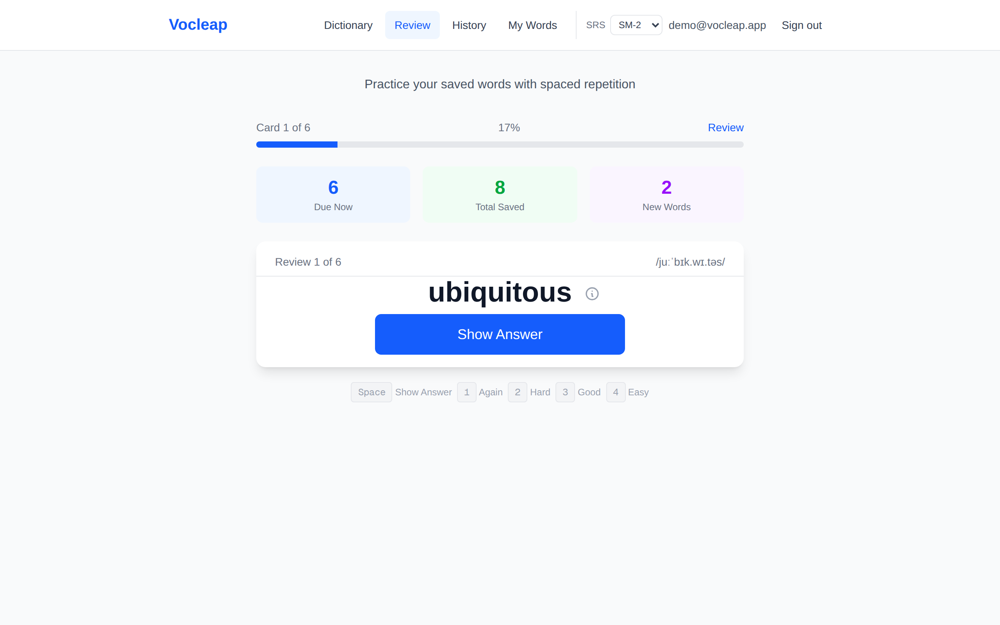
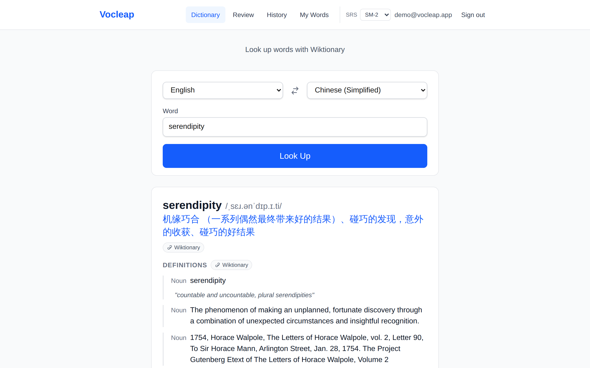
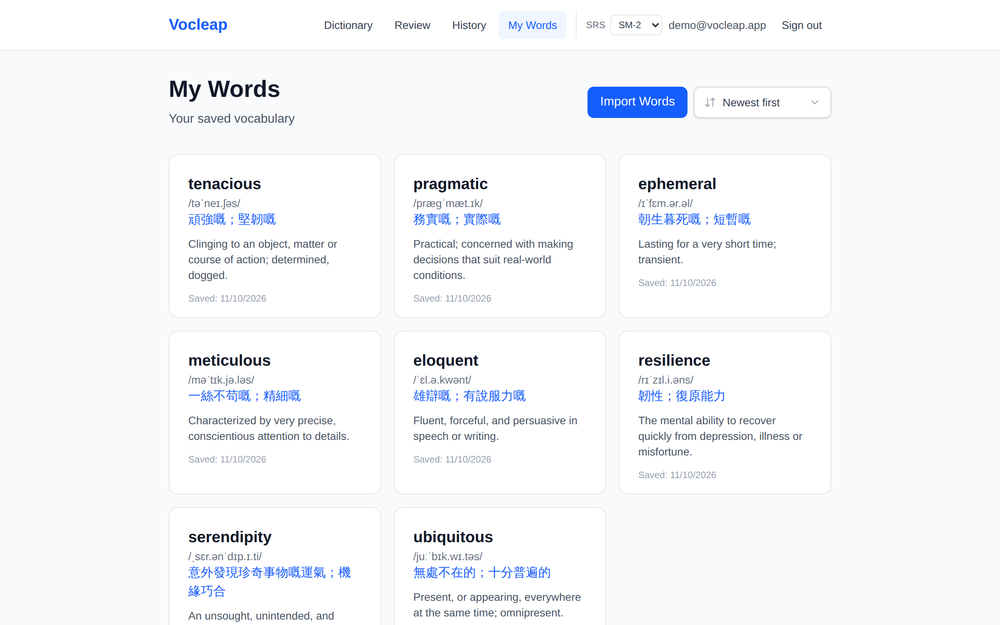

# Vocleap

<p align="center">
  <strong>An open-source vocabulary learning PWA that respects your privacy and works offline.</strong>
</p>

<p align="center">
  <a href="https://vocleap.vercel.app"><strong>🚀 Try the live demo</strong></a>
  <span> · </span>
  <a href="docs/self-hosting.md"><strong>📦 Self-host</strong></a>
  <span> · </span>
  <a href="docs/architecture.md"><strong>🏗 Architecture</strong></a>
  <span> · </span>
  <a href="CHANGELOG.md"><strong>📝 Changelog</strong></a>
</p>

<p align="center">
  
  
  
  
  
</p>

<p align="center">
  
  &nbsp;
  
</p>
<p align="center">
  
</p>

---

## Why Vocleap?

Most vocabulary apps either lock your data behind a subscription, require an account just to try them, or don't work offline. Vocleap is different:

- **🔒 Your data, your rules** — Self-host on your own infrastructure (Vercel + Turso, or any Node.js host with SQLite). No vendor lock-in.
- **📴 Offline-first PWA** — Install to your home screen, review on the subway, sync when you're back online.
- **🧠 Science-backed SRS** — SM-2 by default, with **FSRS** (Free Spaced Repetition Scheduler) available per-user. Interval previews show you exactly when a word will return before you rate it.
- **🔄 Cross-device sync** — Your review position persists across devices without losing your place in the queue.
- **🌐 Dictionary without walls** — Wiktionary-powered definitions, examples, and phonetics. No account needed to look up words.
- **📦 Batch import** — Drop in `.txt`, `.json`, or `.csv` word lists and start reviewing immediately.

---

## Features at a Glance

| Feature | Details |
|---------|---------|
| **Dictionary Lookup** | Wiktionary definitions, examples, IPA phonetics, audio pronunciation, translation fallback |
| **Spaced Repetition** | SM-2 (default) • FSRS (opt-in per user) • Interval preview on rating buttons |
| **Cross-Device Sync** | Encrypted session tokens • Review queue position persists across devices |
| **Multi-User Accounts** | Email/password • scrypt-hashed passwords • Rate-limited auth endpoints |
| **Review History** | Per-word timeline with before/after memory-state snapshots |
| **Word Management** | Batch import (txt/json/csv) • Sortable cards • Phonetic display |
| **PWA** | Service worker caching • Install prompt • Offline review capability |
| **Timezone-Aware** | Due dates calculated at local midnight, wherever you are |

---

## Tech Stack

| Layer | Technology |
|-------|------------|
| **Framework** | Next.js 16 (App Router, Turbopack) · React 19 · TypeScript |
| **Styling** | Tailwind CSS 4 |
| **Database** | SQLite via `better-sqlite3` (local) · `@libsql/client` (Turso) — unified async adapter |
| **SRS** | SM-2 (custom) · `ts-fsrs` (FSRS) — switchable per user |
| **Auth** | scrypt password hashing · Hashed session tokens · Origin-checked CSRF protection |
| **Dictionary** | Wiktionary API via `anylang` |
| **PWA** | `next-pwa` (Workbox) |
| **Testing** | Playwright (E2E, isolated SQLite per test) |
| **Analytics** | Vercel Analytics (opt-in, privacy-friendly) |

---

## Quick Start

**Prerequisites:** [Bun](https://bun.sh) ≥ 1.2 (Node ≥ 20 also works)

```bash
# Clone and enter the repo
git clone https://github.com/zesov/vocLeap.git
cd vocLeap

# Install dependencies
bun install

# Configure environment (local SQLite works out of the box)
cp .env.example .env

# Start development server
bun run dev
```

Open **http://localhost:3000**, sign up, and start saving words. The local SQLite database (`data/vocleap.db`) is created automatically on first run.

> **Production deployment?** See the **[Self-hosting Guide](docs/self-hosting.md)** for Turso setup, Vercel region colocation, migrations, and environment variables.

---

## Project Structure

```
vocleap/
├── app/                    # Next.js App Router
│   ├── (public)/          # Home, Dictionary, Login, Signup
│   ├── (app)/             # Protected: Review, Words, History, Settings
│   └── api/               # REST endpoints: words, reviews, settings, auth, translate
├── components/            # Shared UI (NavBar, ReviewSession, DictionaryLookup, UI primitives)
├── lib/
│   ├── auth/              # scrypt, session tokens, rate limiting, guards
│   ├── db/                # Dual-backend SQLite adapter + operations
│   ├── dictionary/        # Wiktionary client
│   └── srs/               # SM-2 & FSRS scheduling (switchable per user)
├── docs/                  # Self-hosting, Architecture
├── scripts/               # Migrations, backfills, maintenance
├── tests/e2e/             # Playwright specs
└── public/                # Static assets, PWA manifest
```

---

## Available Scripts

| Command | Purpose |
|---------|---------|
| `bun run dev` | Start Turbopack dev server |
| `bun run build` / `bun run start` | Production build / serve |
| `bun run lint` | ESLint |
| `bunx tsc --noEmit` | Type-check |
| `bunx playwright test` | E2E tests (isolated dev server + SQLite) |
| `bun run migrate` | Apply schema migrations (idempotent) |
| `bun run migrate:multiuser` | One-shot `words` table rebuild for multi-user |
| `bun run claim-owner` | Assign pre-multi-user words to an account |
| `bun run backfill:phonetic` | Backfill phonetics for saved words |
| `bun run reset:unreviewed` | Clean up placeholder review rows |

---

## Documentation

- **[Self-hosting Guide](docs/self-hosting.md)** — Environment variables, Turso, migrations, Vercel deployment, upgrading
- **[Architecture Overview](docs/architecture.md)** — DB adapter, auth, SRS, and sync layer internals
- **[Contributing](CONTRIBUTING.md)** — Development setup, conventions, PR checklist
- **[Security Policy](SECURITY.md)** — Responsible disclosure
- **[Changelog](CHANGELOG.md)** — Version history

---

## Acknowledgments

Vocleap stands on the shoulders of giants. Special thanks to the authors and maintainers of:

### Core Dependencies
- **[Next.js](https://nextjs.org/)** — The React framework for production (Vercel team)
- **[React](https://react.dev/)** — A JavaScript library for building user interfaces (Meta)
- **[Tailwind CSS](https://tailwindcss.com/)** — Utility-first CSS framework (Tailwind Labs)
- **[TypeScript](https://www.typescriptlang.org/)** — JavaScript with syntax for types (Microsoft)

### Database & Storage
- **[better-sqlite3](https://github.com/WiseLibs/better-sqlite3)** — Fast, simple SQLite3 bindings (Joshua Wise)
- **[@libsql/client](https://github.com/libsql/libsql)** — libSQL client for Turso/embedded SQLite (Turso team)
- **[ts-fsrs](https://github.com/open-spaced-repetition/ts-fsrs)** — TypeScript implementation of FSRS (Open Spaced Repetition)

### Authentication & Security
- **[scrypt](https://github.com/barrysteyn/node-scrypt-async)** — CPU-hard password hashing (Barry Steyn)
- **Web Crypto API** — Native browser cryptography for session tokens

### Dictionary & Language
- **[anylang](https://github.com/anylang/anylang)** — Multi-language dictionary API wrapper
- **[Wiktionary](https://www.wiktionary.org/)** — Free multilingual dictionary (Wikimedia Foundation)

### PWA & Tooling
- **[next-pwa](https://github.com/shadowwalker/next-pwa)** — Zero-config PWA for Next.js (ShadowWalker)
- **[Workbox](https://developers.google.com/web/tools/workbox)** — Service worker libraries (Google Chrome team)
- **[Playwright](https://playwright.dev/)** — Reliable end-to-end testing (Microsoft)
- **[ESLint](https://eslint.org/)** — Pluggable JavaScript linter
- **[Bun](https://bun.sh/)** — Fast JavaScript runtime & package manager (Oven)

### Analytics & Observability
- **[@vercel/analytics](https://vercel.com/analytics)** — Privacy-friendly web analytics (Vercel)

---

## AI Assistance

This project was developed with the help of AI coding assistants:

- **[Claude](https://claude.ai/)** (Anthropic) — Architecture design, code review, debugging, documentation
- **[GitHub Copilot](https://github.com/features/copilot)** — Inline completions, boilerplate generation
- **[OpenCode](https://opencode.ai/)** — Agentic development workflows, skill-based automation

All AI-generated code has been reviewed, tested, and validated by humans. AI is a tool, not an author.

---

## Contributing

We welcome contributions of all kinds — bug reports, feature ideas, documentation improvements, and pull requests.

Please read our **[Contributing Guide](CONTRIBUTING.md)** for:
- Development setup
- Code conventions (Conventional Commits, data access patterns, auth guards)
- PR checklist (lint, typecheck, E2E tests)
- Architecture constraints (DB adapter, schema changes, auth)

---

## Security

If you discover a security vulnerability, please follow our **[Security Policy](SECURITY.md)** for responsible disclosure. Do not open a public issue.

---

## License

**MIT License** — see [LICENSE](LICENSE) for details.

Copyright (c) 2024-present Gavin

---

<p align="center">
  Made with ❤️ by <a href="https://github.com/zesov">Gavin</a> and contributors
</p>